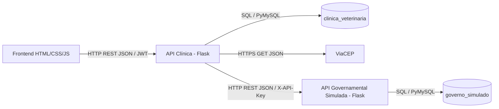

# SDM – Sistema de Gestão de Clínica Veterinária

Projeto A3 – Sistemas Distribuídos e Mobile | IBMR | 2026.2

Sistema web para gestão de tutores, animais e atendimentos veterinários, com integração à API pública ViaCEP e a uma API governamental simulada para registro de animais e vacinação antirrábica.

Documentação complementar: [Guia do projeto](docs/GUIA_DO_PROJETO.md), [Etapas de desenvolvimento](docs/ETAPAS_DE_DESENVOLVIMENTO.md) e [DER](docs/der/A3_DER_Clinica_Veterinaria.pdf). Esses documentos devem acompanhar a versão final dos schemas SQL.

## Arquitetura



As APIs executam em processos distintos e possuem bancos logicamente independentes, ainda que hospedados na mesma instância MariaDB no ambiente acadêmico. O frontend não acessa diretamente os bancos nem utiliza a chave governamental. A comunicação local utiliza HTTP; a consulta ao ViaCEP utiliza HTTPS.

| Pasta | Responsabilidade | Porta local |
|---|---|---|
| `frontend/` | Interface web responsiva, HTML, CSS e JavaScript (Fetch API) | 8000 ou 5500 |
| `api-clinica/` | API REST privada, Flask, PyMySQL, PyJWT e Requests | 5000 |
| `api-governo/` | API REST governamental simulada, Flask e PyMySQL | 5001 |
| `database/` | Schemas e dados iniciais MariaDB | 3306 (padrão) |
| `docs/` | DER, documentação, gerador OpenAPI, coleções Postman e evidências | — |

## Como instalar e executar

### 1. Pré-requisitos

- Windows e PowerShell (comandos abaixo); Python 3.10+ conforme requisito original do projeto. O ambiente de desenvolvimento utilizado possui Python 3.14.8.
- XAMPP com MariaDB e phpMyAdmin; navegador web.
- Git para controle de versão; Postman e VS Code são opcionais para execução, úteis para desenvolvimento e testes.
- Internet para instalação de dependências, consulta ViaCEP e carregamento de recursos externos da interface, quando aplicável.

Execute os comandos a partir da pasta principal do projeto, salvo indicação contrária.

### 2. Banco de dados

Inicie MySQL e Apache no painel do XAMPP. Abra http://localhost/phpmyadmin e importe os arquivos SQL nesta ordem:

1. `database/clinica/schema.sql`
2. `database/clinica/seed.sql`
3. `database/governo/schema.sql`

Confira a existência das bases `clinica_veterinaria` (11 tabelas) e `governo_simulado` (3 tabelas). O seed inclui catálogos iniciais e um veterinário fictício de demonstração.

**Atenção:** o procedimento destina-se a uma instalação nova. Faça backup antes de modificar bases existentes. A importação de um schema com `CREATE TABLE IF NOT EXISTS` não migra automaticamente tabelas antigas. Não exclua bases que contenham dados ou evidências de testes. Os fluxos foram testados em MariaDB local; a instalação limpa com os scripts finais ainda deve ser validada.

### 3. Configurar os ambientes

Crie os arquivos `.env` a partir dos exemplos, somente se ainda não existirem:

```powershell
if (-not (Test-Path .\api-clinica\.env)) { Copy-Item .\api-clinica\.env.example .\api-clinica\.env }
if (-not (Test-Path .\api-governo\.env)) { Copy-Item .\api-governo\.env.example .\api-governo\.env }
```

Gere duas chaves aleatórias distintas em uma instalação nova:

```powershell
python -c "import secrets; print(secrets.token_hex(32))"
python -c "import secrets; print(secrets.token_hex(32))"
```

Use a primeira como `SECRET_KEY` da clínica e a segunda como `GOVERNO_API_KEY` **idêntica nas duas APIs**. Não reutilize chaves de outras instalações. Não compartilhe a saída dos comandos.

Exemplo de configuração de `api-clinica/.env`:

```dotenv
DB_HOST=localhost
DB_PORT=3306
DB_USER=root
DB_PASSWORD=
DB_NAME=clinica_veterinaria
SECRET_KEY=SUBSTITUA_PELA_CHAVE_JWT
GOVERNO_URL=http://localhost:5001
GOVERNO_API_KEY=SUBSTITUA_PELA_CHAVE_COMPARTILHADA
```

Exemplo de `api-governo/.env`:

```dotenv
DB_HOST=localhost
DB_PORT=3306
DB_USER=root
DB_PASSWORD=
DB_NAME=governo_simulado
GOVERNO_API_KEY=SUBSTITUA_PELA_MESMA_CHAVE_COMPARTILHADA
```

Ajuste usuário, senha e porta conforme seu MariaDB. O exemplo de root sem senha corresponde somente a uma configuração local de desenvolvimento. Substitua todos os marcadores antes de iniciar. Nunca publique `.env`, chaves reais ou tokens.

### 4. Iniciar a API da clínica

Em um terminal PowerShell na raiz:

```powershell
cd api-clinica
py -m venv venv
.\venv\Scripts\python.exe -m pip install -r requirements.txt
.\venv\Scripts\python.exe run.py
```

Mantenha o terminal aberto. Disponibilidade: http://localhost:5000/.

### 5. Iniciar a API governamental

Em outro terminal, novamente a partir da raiz:

```powershell
cd api-governo
py -m venv venv
.\venv\Scripts\python.exe -m pip install -r requirements.txt
.\venv\Scripts\python.exe run.py
```

Mantenha o terminal aberto. Disponibilidade: http://localhost:5001/. As rotas de negócio governamentais exigem o cabeçalho `X-API-Key`; a raiz é pública.

Os comandos utilizam diretamente o Python do ambiente virtual para dispensar a ativação via PowerShell. Em execuções posteriores, basta iniciar `run.py` com o ambiente já criado.

### 6. Iniciar o frontend

Em um terceiro terminal, a partir da raiz:

```powershell
cd frontend
python -m http.server 8000
```

Abra http://localhost:8000/login.html. Alternativamente, use Live Server no VS Code, com a URL correspondente à pasta servida (por exemplo, http://127.0.0.1:5500/frontend/login.html quando a raiz do projeto é servida).

**Login fictício de demonstração** (seed SQL):

- E-mail: `dev@clinica.com`
- Senha: `clinica123`

Essas credenciais são exclusivas do ambiente acadêmico. Não utilize dados pessoais reais. Desative a conta de demonstração antes de qualquer implantação real.

## Funcionalidades e segurança

- Cadastro de veterinários com senha armazenada em hash, confirmação de e-mail simulada e token de uso único com validade de 30 minutos. O token é exibido no terminal da API da clínica para fins acadêmicos, sem envio real de e-mail.
- Login de veterinários ativos e confirmados; autenticação JWT nas rotas protegidas. O logout revoga o identificador `jti` do token no banco, impedindo sua reutilização. A situação do veterinário é verificada nas requisições protegidas.
- Tutores: cadastro, edição, consulta, inativação e endereço com preenchimento via CEP ou manual.
- Animais: vínculo com tutor, espécie e raça compatível, inclusive sem raça definida (SRD).
- Atendimento: consultas, histórico clínico, vacinas aplicadas e próxima dose.
- Microchip RFID: vínculo lógico, unicidade do número e histórico de vinculação/desvinculação; não depende de leitor físico.
- Dashboard e acompanhamento das integrações, com filtros, protocolos, tentativas e reenvio quando permitido.

## Integração governamental e tolerância a falhas

O cadastro e a atualização de animais, as alterações de vínculo de microchip e o registro de vacinas antirrábicas geram operações de integração. Vacinas não antirrábicas não exigem comunicação governamental.

1. A clínica grava o dado de negócio e a operação de integração com seu `payload_original` e `chave_idempotencia` na mesma transação local.
2. Após o commit, tenta enviar a operação à API governamental com `X-API-Key` e timeout. A tentativa inicial é síncrona, não um processo de background.
3. A API governamental verifica a chave de acesso, a idempotência e os dados recebidos, grava em seu próprio banco e devolve um protocolo quando aceita a operação.
4. A clínica registra o resultado, a quantidade de tentativas e os horários. Se o governo estiver indisponível, o dado clínico permanece salvo e a operação pode ficar pendente.
5. O veterinário pode solicitar reenvio pela interface ou por `POST /integracoes/{id_integracao}/reenviar`, reutilizando o payload e a chave originais. O resultado deve ser conferido pelo status retornado, não apenas pelo HTTP 200.

| Status | Significado |
|---|---|
| `PENDENTE` | Aguarda tentativa ou nova tentativa após falha transitória |
| `ENVIADO` | Tentativa iniciada, ainda sem resultado definitivo registrado |
| `CONFIRMADO` | Protocolo de aceitação recebido |
| `FALHA` | Erro registrado, sujeito a análise e reenvio quando elegível |

Operações pendentes, com falha ou enviadas sem conclusão por pelo menos dois minutos podem ser elegíveis para reenvio (`pode_reenviar`). Operações confirmadas não são reenviadas. Não há garantia de reenvio automático periódico.

A API governamental utiliza a chave de idempotência e o hash do conteúdo para evitar duplicação e rejeitar reutilização incompatível da chave. A `versao_origem` protege o cadastro animal contra sobrescrita por versões antigas. A vacinação antirrábica pode ser recebida mesmo antes do cadastro governamental do animal; a associação ao registro governamental pode ocorrer posteriormente. O indicador `antirrabica` identifica o tipo de vacina, não confirma sua sincronização.

## Documentação Swagger/OpenAPI

| API | Swagger UI | Especificação |
|---|---|---|
| Clínica | http://localhost:5000/docs | http://localhost:5000/openapi.json |
| Governo | http://localhost:5001/docs | http://localhost:5001/openapi.json |

Versão documentada: 1.2.0 (OpenAPI 3.0.3). Clínica: 27 caminhos e 46 operações HTTP. Governo: 5 caminhos e 5 operações HTTP.

Na clínica, obtenha um JWT em `POST /auth/login` e informe-o em **Authorize**. No governo, informe a chave compartilhada em **Authorize** para as rotas protegidas. Não compartilhe o Curl gerado pelo Swagger quando contiver credenciais.

Para regenerar as especificações após alterações nas rotas ou schemas, edite `docs/gerar_openapi.py` e execute na raiz:

```powershell
python -m py_compile .\docs\gerar_openapi.py
python .\docs\gerar_openapi.py
```

## Testes e evidências

As coleções estão em `docs/postman/`:

- `API_Clinica_Veterinaria.postman_collection.json`
- `API_Governamental_Simulada.postman_collection.json`
- `Testes_Integracao_Clinica_Governo.postman_collection.json`

Importe no Postman, configure URLs, credenciais fictícias, JWT e API Key localmente conforme as variáveis da coleção. Ajuste IDs, datas e dados únicos ao banco utilizado. Não exporte segredos preenchidos. Os registros de evidência ficam em `docs/evidencias/`.

Validações realizadas no ambiente local durante o desenvolvimento incluem confirmação de e-mail (token inválido, válido e reutilizado), login e bloqueio de veterinário inativo, revogação JWT, rotação de API Key, integração de animais e vacinas, vacina não antirrábica sem integração, indisponibilidade governamental com persistência local, reenvio e bloqueio de reenvio confirmado. Também foram validados o carregamento dos dois Swagger e uma consulta governamental autenticada com HTTP 200.

### Roteiro de demonstração de falha e recuperação

1. Com as duas APIs ativas, entre na clínica e selecione um animal de teste.
2. Pare somente a API governamental (Ctrl+C em seu terminal).
3. Registre uma vacina antirrábica aplicada, com lote fictício único.
4. Confirme a persistência da vacina e a integração pendente, sem protocolo.
5. Reinicie a API governamental e clique em **Reenviar** na tela de integrações.
6. Confira status `CONFIRMADO`, protocolo e incremento de tentativas; verifique que não foi criada uma segunda vacina para a mesma operação.

Esse fluxo foi demonstrado pelo frontend e conferido nos bancos locais. Os testes executados não equivalem a uma auditoria de segurança, teste de carga ou validação integral de instalação limpa. O relatório de testes deve discriminar casos executados, evidências e eventuais pendências.

## Limitações do ambiente acadêmico

A API governamental é simulada e não transmite dados a órgãos reais. A confirmação de e-mail é simulada. O ambiente local utiliza HTTP, servidor Flask de desenvolvimento e credenciais de demonstração. Para produção seriam necessários HTTPS, servidor WSGI adequado, contas de banco com privilégios mínimos, gerenciamento de segredos, revisão de CORS e armazenamento de sessão, monitoramento e testes adicionais.

## Trabalho em grupo (Git)

- `main` só recebe código revisado e funcional.
- Cada tarefa em uma branch: `git checkout -b feature/nome-da-tarefa`.
- Abra um Pull Request para `main` e peça revisão de um colega.
- Commits pequenos e com mensagem clara.
- Nunca publique `.env`, ambientes virtuais, backups com dados pessoais, tokens ou chaves; publique somente `.env.example` com valores fictícios.
- Mantenha os schemas SQL, DER e documentação sincronizados com as alterações de banco e API.
- Cada módulo de rotas fica em um arquivo próprio em `api-clinica/app/routes/` para evitar conflitos.

## Cronograma

| Semana | Entrega |
|---|---|
| 1 (29/10) | Modelagem e arquitetura |
| 2 (05/11) | Banco de dados e API privada |
| 3 (12/11) | Interface web e funcionalidades clínicas |
| 4 (19/11) | API governamental e integração |
| 5 (26/11) | Testes, documentação e apresentação |
